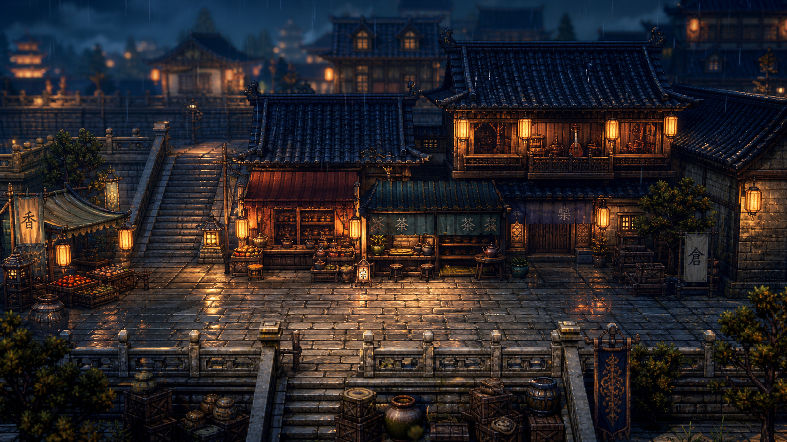
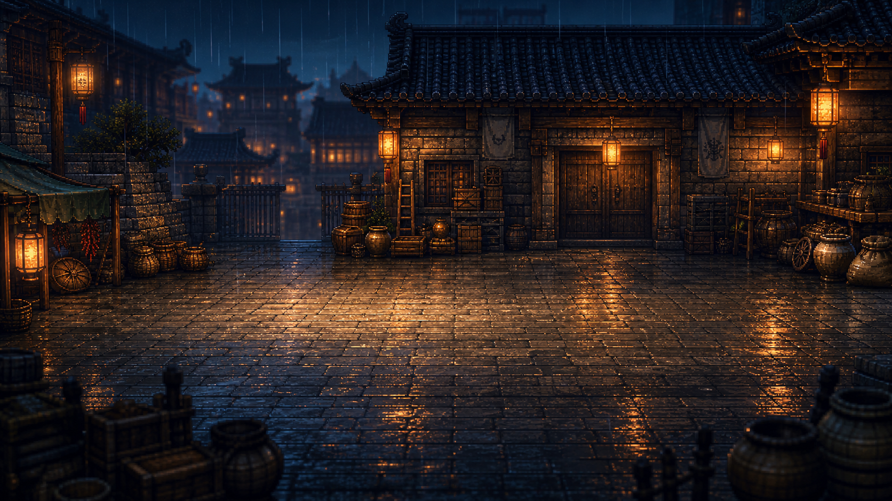

# 长安行旅 · Traveler in Chang'an

一款以盛唐长安为背景的 **唐风 HD-2D 叙事 RPG** 原型，使用 **Godot 4.6 + GDScript** 开发。

当前版本实现了第一章《西市灯灭》的完整可玩切片：雨夜西市巡街、五张地图之间的往返调查、线索收集，以及仓库地窖中的回合制战斗。玩家的身份是万年县不良人**沈晏**。



> 上图为游戏内实际使用的西市场景背景（HD-2D 风格占位美术）。

---

## 当前进度

| 模块 | 状态 |
| --- | --- |
| 主场景与开场演出（章节标题 / 人物立绘 / 三段独白） | ✅ 已完成 |
| 西市五地图横向探索与镜头跟随 | ✅ 已完成 |
| NPC 对话、线索收集、交互高亮与对话气泡 | ✅ 已完成 |
| 仓库解锁条件（2 条线索）与地图转场淡入淡出 | ✅ 已完成 |
| 回合制战斗（HP / BP / 弱点 / 护盾 / 破防 / 格挡 / 重开） | ✅ 已完成 |
| 战斗结束回流西市、章节结局 | 🚧 待实现 |
| 章节状态机、四大线索链、隐藏成就 | 🚧 待实现 |
| 存档、设置、音频 | ⬜ 未开始 |
| 导出配置（Windows / Web） | ⬜ 未开始 |

```text
场景流程：TownScene（开场演出 → 调查 → 地窖）→ BattleScene
```

---

## 操作方式

| 操作 | 按键 |
| --- | --- |
| 移动 | `WASD` / 方向键 |
| 交互（对话、调查、进门、战斗） | `E` / `Space` / `Enter` |
| 开场独白推进 | `E` / `Space` / `Enter` |
| 战斗指令 | 鼠标点击右侧按钮 |

---

## 运行项目

### 环境要求

- **Godot 4.6** 或更高版本（项目由 Godot 4.6.2 创建，4.5 及以下打开会提示版本不符）
- 无需额外插件或第三方依赖，纯 GDScript 项目
- 渲染后端：`GL Compatibility`；物理引擎：`Jolt Physics`

### 从编辑器运行

1. 打开 Godot，选择 **导入 / Import**。
2. 选择本目录下的 `project.godot`。
3. 按 `F5`（或点击右上角播放按钮）。

主场景已在 `project.godot` 中配置为 `res://scenes/TownScene.tscn`，无需手动指定。

### 从命令行运行

```bash
godot --path ./trip/traveler-in-changan
```

项目目前**没有导出预设**，请直接在编辑器中运行；导出前需要先补 `export_presets.cfg`。

---

## 当前可玩内容

### 1. 开场演出

进入游戏后先播放第一章序章：章节标题「第一章 西市灯灭」、沈晏立绘与身份标签，以及三段旁白，交代"急牒入井"的起因。播完后镜头跟随沈晏从街口走入西市。

### 2. 五张地图的箱庭式探索

世界横向拼接为一条 8060×720 的街道，分为五段，各有独立背景、交互对象与转场入口：

| 地图 | 内容 |
| --- | --- |
| 西市主街 | 枢纽区域：现场尸体、香料巷 / 茶肆 / 乐坊入口、仓库大门 |
| 香料巷 | 线索：罗三娘、破油罐 |
| 茶肆后院 | 线索：脚夫阿犁、封箱 |
| 乐坊侧门 | 线索：纪闻笛、乐器箱 |
| 仓库地窖 | 线索：账箱；Boss 韩折冲 |

玩家靠近可交互对象时，对象会放大高亮，头顶弹出交互提示，并显示纸卷样式的对话气泡。共 **8 个线索物件 + 7 个传送点 + 1 个仓库入口 + 1 个战斗触发点**。

### 3. 线索与仓库解锁

- 每个物件只能被调查一次，已调查对象会改为提示后续目标。
- 左上角实时显示「线索：N/2」，右下角小地图同步显示进度。
- **收集到 2 条线索后**，主街最右侧的仓库才会解锁；否则会提示"仓库门被锁住了"。
- 进入仓库地窖后，靠近韩折冲即淡出切换到战斗场景。

### 4. 回合制战斗



| 机制 | 数值 / 说明 |
| --- | --- |
| 玩家（不良人） | HP 120，BP 上限 5，初始 1 点 |
| 敌人（盗匪） | HP 90，护盾 2 层，弱点为「刀」「火」 |
| 挥刀 / 火符 | 16 / 12 点伤害，均命中弱点，命中后护盾 −1 |
| 增幅斩 | 消耗 1 BP，造成 32 点伤害 |
| 格挡 | 本回合受到的伤害由 14 降至 7 |
| 破防 | 护盾归零后敌人进入破防，受伤 ×1.5，持续 1 回合后护盾重置 |
| 行动顺序 | 屏幕顶部菱形图标显示出手顺序 |
| 其他 | 动作动画（冲刺斩、火符飞行、格挡光弧、受击抖动）、战斗日志、重开按钮 |

---

## 目录结构

```text
traveler-in-changan/
├── project.godot            # 项目配置：主场景、分辨率、渲染与物理设置
├── icon.svg                 # 项目图标
├── scenes/
│   ├── TownScene.tscn       # 主场景（调查 / 探索）
│   └── BattleScene.tscn     # 战斗场景
├── scripts/                 # 16 个 GDScript 文件
│   ├── town_scene.gd        # 探索主逻辑：地图、交互、线索、转场、开场演出
│   ├── battle_scene.gd      # 战斗逻辑、UI 构建与动画
│   ├── *_sprite.gd          # 角色 / NPC 立绘与序列帧
│   ├── hd2d_scene_fx.gd     # 雨、灯火、地面反光等场景氛围层
│   ├── hud_overlay.gd       # 地点牌与小地图
│   ├── dialogue_balloon.gd  # 对话气泡
│   └── smoke_test.gd        # TownScene 加载冒烟测试脚本
├── assets/
│   ├── characters/          # 角色立绘、战斗像素图、NPC 序列帧
│   ├── maps/                # 五张场景背景 + 战斗背景
│   └── reference/           # HD-2D 风格板
├── data/
│   └── zh_cn.json           # 探索场景中文文案（标题、提示、线索、对白）
├── docs/                    # 世界观、剧本、关卡与美术设计文档
├── screenshots/             # 截图占位（待替换为实机画面）
└── README.md
```

> `.godot/` 为 Godot 自动生成的导入缓存，已加入 `.gitignore`，请勿提交。

---

## 实现要点

- **纯代码构建 UI**：两个场景的 `.tscn` 只有根节点，地图背景、NPC、HUD、按钮与特效全部在 GDScript 中动态生成，便于快速迭代。
- **横向拼接式地图**：五段地图以 `Rect2` 划分世界坐标，摄像机按当前地图边界做钳制，玩家跨图时通过淡入淡出 + 安全落点计算完成传送。
- **数据驱动的文案**：探索场景文案集中在 `data/zh_cn.json`，脚本通过 `tr_text()` / `format_text()` 读取。
- **氛围层**：`hd2d_scene_fx.gd` 用 `_draw()` 绘制雨丝、灯笼光晕、地面反光与暗角，营造雨夜西市的光影。

---

## 设计文档

`docs/` 下保存了完整的世界观与制作资料：

| 文档 | 内容 |
| --- | --- |
| `narrative-world-bible.md` | 世界观圣经：时代背景、主线母题、玄牒暗线 |
| `playable-character-arcs.md` | 八名可游玩角色的箱庭式篇章设计（v3） |
| `character-script-pack-v1.md` | 八名主角的剧本包初稿 |
| `cinematic-script-pass-v2.md` | 电影化扩写版剧本（镜头调度、情绪弧线） |
| `chapter-writing-template.md` | 角色篇章写作模板 |
| `box-garden-exploration-design.md` | 箱庭式多地图探索结构 |
| `gameplay-interaction-details.md` | 可互动物件、隐藏成就、章节机制细节 |
| `first-chapter-production-plan.md` | 第一章《西市灯灭》制作方案 |
| `development-roadmap.md` | 开发里程碑 |
| `visual-style-guide.md` | HD-2D 视觉风格指南 |
| `image-prompts.md` / `asset-plan.md` | 美术生成提示词与资产计划 |

---

## 下一步计划

按 `docs/development-roadmap.md` 的 Milestone 7，当前优先补齐：

1. 新增 `data/chapter_01_zh_cn.json`，统一章节文本、线索、成就数据。
2. 加入章节阶段状态机：开场巡街 → 命案现场 → 仓库就绪 → 结局。
3. 把线索从 2 条扩展为 4 条完整线索链。
4. 补充隐藏交互与首个成就判定。
5. 让调查质量影响仓库 Boss 战的开场演出。
6. 战斗结束后返回西市，播放章节结局。

更长期的目标是把第一章扩展为 30–45 分钟的高完成度切片，再逐步做成 3–4 小时的完整箱庭章节。

---

## 素材说明

`assets/` 中的场景背景、角色立绘与风格板目前为 **AI 生成的占位美术**，用于验证视觉方向与玩法，后续会逐步替换为正式资产。项目暂未附带开源许可证。
